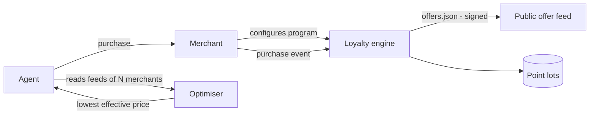

# Architecture — agent-miles

## 1. Scope
Loyalty programmes designed for agent customers: machine-readable value, fraud-resistant, optimisable.
**MVP:** earn rules (category rates, first-purchase bonus, dated promos, tier multipliers),
trailing-12-month tiers, expiring point lots with soonest-expiry-first burn, catalogue redemption,
pay-with-points, fraud limits (daily cap, velocity, self-referral), JSON offer feed, cross-merchant
optimiser by effective price.
**Product:** coalition programmes, signed feeds, agent-only perks.

## 2. System context

## 3. Ledger model
Points are **lots** `[earned_on, expires_on, remaining]`, not a single balance. Balance = Σ
unexpired remaining. Burn takes from the soonest-expiring lots first, which maximises member
value and is the regulator-friendly choice. Tier = highest threshold met by trailing-365-day spend.

## 4. Design decisions
- **Lots over a running balance.** Expiry and partial burns are exact and auditable.
- **The offer feed is the agent interface:** earn rates, active promos, point value in $, tier
  thresholds and reward values. An agent can compute `effective_price = price − points × point_value`
  without scraping.
- **Fraud limits clip earning rather than rejecting purchases** (daily cap), so legitimate
  customers aren't blocked at checkout. Velocity limits do reject.

## 5. Production architecture
Postgres ledger (lots, transactions, idempotent purchase events keyed by order ID), a feed
publisher (Ed25519-signed JSON on a CDN, cache 5 min), partner settlement for coalition earn and
burn, and liability accounting (outstanding points × breakage-adjusted value).

## 6. Risks
Agents optimising purely on price commoditise merchants. Agent-only perks (priority fulfilment,
API discounts) give a non-price reason to choose a merchant.
